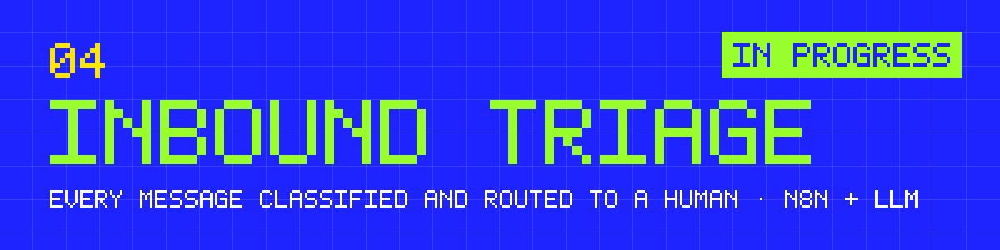
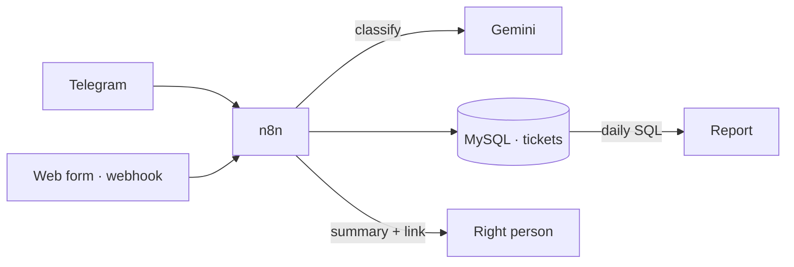

**Every incoming message classified, stored and handed to the right person in seconds.** For a support team that's a ticket queue that sorts itself. For a small business, it means no inquiry gets lost.

`n8n` · `Gemini` · `MySQL` · `SQL` · `Telegram Bot API` · `Postman`

> **En español:** cada mensaje que entra (un pedido de soporte o una consulta de un cliente) se clasifica con IA, se guarda y se le pasa a la persona indicada con un resumen. Lo estoy construyendo en público: abajo está la lista de lo que falta.

## Status: in progress

I'm building this in public. Each step is an [issue](../../issues) and gets closed with the commit that does it.

- [x] **v0**: a first draft generated with AI (webhook → LLM classification → Google Sheets → Gmail draft). It was never run end to end, so it lives in [`v0/`](v0/) as a starting point, not as a result.
- [ ] **Spec**: categories, urgency rules and what always goes to a human (`docs/spec.md`).
- [ ] **Intake**: messages from Telegram and from a webhook (web form).
- [ ] **Classification**: Gemini returns type, urgency and a one-line summary as JSON; invalid answers fall back to "needs a human".
- [ ] **Storage**: a `tickets` table in MySQL instead of a spreadsheet.
- [ ] **Routing**: the right person gets a notification with the summary and a link to reply.
- [ ] **Tests**: unit tests for the code nodes and a Postman collection for the webhook.
- [ ] **Report**: a daily SQL report with volume, categories and time to first response.
- [ ] **Demo**: a 2-minute video of a message going all the way through.
- [ ] **How I built it**: `docs/how-i-built-it.md`, what I asked the AI, what broke and how I checked it.

## The problem

Messages arrive by WhatsApp, Telegram, email and web forms, and someone has to read each one, decide what it is and pass it on. When that person is busy, urgent messages wait behind trivial ones and inquiries get lost. Support teams call it triage; a small business just calls it "we never answered".

## How it will work

## How I build

Spec first, then the AI builds, then I verify with tests and real messages before calling a step done. The spec, the tests and the notes on what broke stay in the repo, so the process can be checked, not just the result.

---

04 · Part of the work of <a href="https://github.com/ayrtongenovesi">Ayrton Genovesi</a>, Rosario, Argentina. I build with AI and make sure it works.
